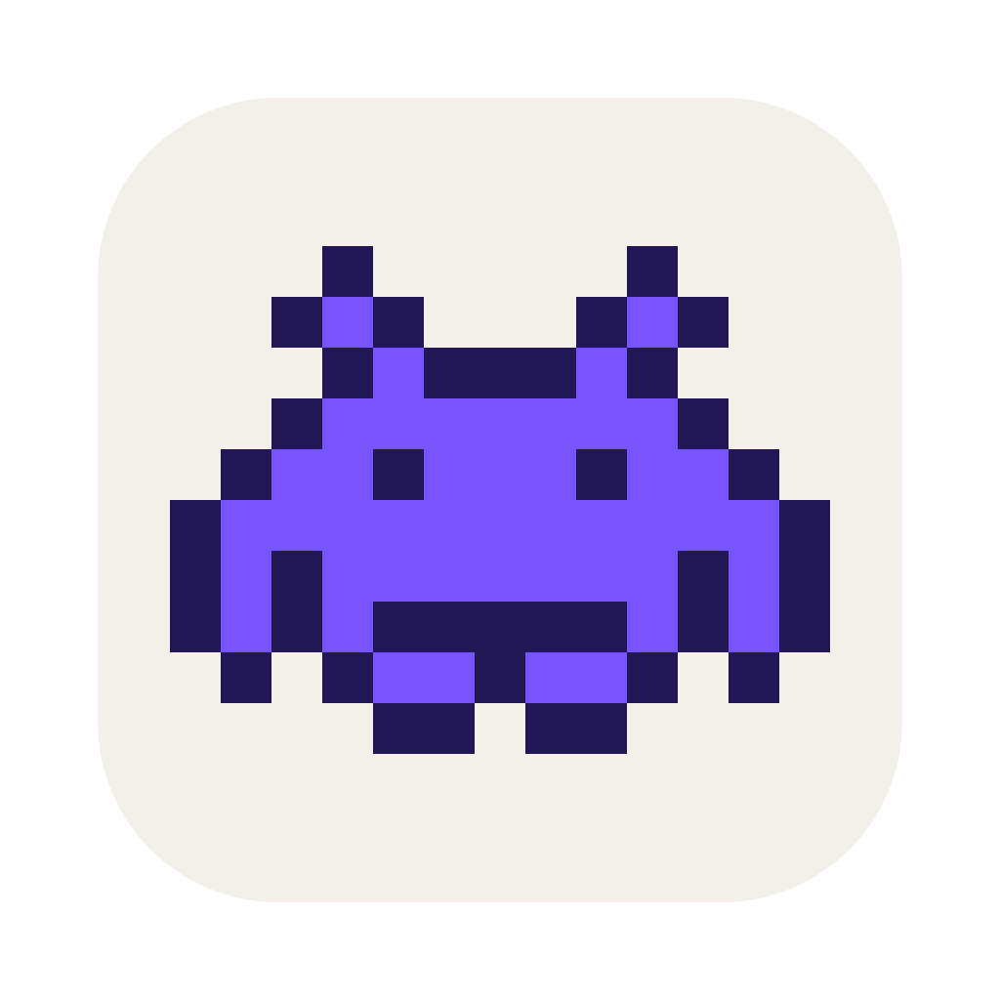

<p align="center"></p>

<h1 align="center">HugWatch</h1>

<p align="center">맥 메뉴바에서 PR 리뷰 · Jira 할당 · 브랜치 병합 · 메일을 10분마다 지켜보고 알려주는 앱</p>

---

## 무엇을 해주나요

메뉴바의 도트 인베이더를 누르면 팝오버가 열려요. 새 소식이 생기면 인베이더가 무지개색으로 폴짝거리고, 맥 알림이 와요.

| 탭 | 보여주는 것 | 알림이 오는 때 |
|---|---|---|
| **새 소식** | 새로 생긴 일만 시간순으로 | — |
| **할 일** | 간단한 할 일 목록 | — |
| **PR** | 내가 올린 열린 PR, 승인·코멘트한 사람 프로필 | 코멘트·승인·수정 요청이 늘었을 때 |
| **메일** | 다우오피스 안 읽은 메일 (선택) | 새 메일이 왔을 때 |
| **Jira** | 나에게 할당된 진행 중 이슈와 상태 | 새로 할당됐을 때 |
| **병합** | 최근 30일 내가 병합한 PR이 develop → release → master 어디까지 갔는지 | 다음 단계에 들어갔을 때 |

- **띄워두기**: 팝오버 오른쪽 위 창 버튼을 누르면 화면에 떠 있는 작은 창이 돼요. 📌로 "항상 맨 위"를 켜고 끌 수 있고, **⌘+ / ⌘− / ⌘0**으로 글자 크기를 바꿔요.
- **할 일**: Enter로 추가하고, 체크하면 완료예요. **우클릭**하면 완료 / 내일로 미루기 / 나중에 / 삭제가 나와요. `ABC-123` 같은 티켓 번호를 쓰면 Jira 링크가 돼요.
- **병합 탭의 D · R · M**: develop · release · master에 들어갔으면 보라색으로 채워져요. 점선 칸은 그 저장소에 없는 단계예요. 오른쪽 초록 배지는 Jira 상태예요. release에서 먼저 배포하는 팀은 M보다 이걸 보면 돼요.

## 설치

필요한 것: **macOS 15 이상**, **Xcode Command Line Tools**

```bash
xcode-select --install   # 이미 깔려 있으면 넘어가요
git clone https://github.com/E-JIWON/hugwatch.git
cd hugwatch
./build.sh install
```

`~/Applications/HugWatch.app`에 설치되고 바로 실행돼요. 처음 켜면 **설정 창**이 열려요.

> 맥북 화면에서 메뉴바 아이콘이 안 보이면 노치 뒤에 숨은 거예요. 외부 모니터 메뉴바에서 **⌘를 누른 채 인베이더를 오른쪽으로 끌어** 옮기거나, 다른 메뉴바 아이콘을 줄여주세요.

### 업데이트

```bash
cd hugwatch && git pull && ./build.sh install
```

## 처음 설정

메뉴바 인베이더 → 팝오버 아래 **⚙︎ 설정**. 필요한 것만 채우면 되고, 비워둔 기능은 탭에서 빠져요.
다 넣고 **저장하고 확인**을 누르면 연결 결과가 바로 보여요(예: `Jira ✓ 3개`, `Bitbucket ✗ …`).

### 1. Atlassian 계정 이메일
Jira·Bitbucket에 로그인하는 **회사 Atlassian 계정 이메일**이에요. 두 서비스가 같이 써요.

### 2. Jira — 나에게 할당된 일
1. **사이트 주소**: 브라우저에서 Jira를 열었을 때 주소 앞부분이에요. 예: `company.atlassian.net`
2. **API 토큰** 만들기
   1. <https://id.atlassian.com/manage-profile/security/api-tokens> 접속
   2. **API 토큰 만들기**(Create API token) 클릭 — *"범위가 있는"이 붙지 않은* 일반 버튼
   3. 이름(예: `hugwatch`)과 만료일 입력 → **만들기**. 만료일 기본값은 일주일 뒤이고, 최대 1년까지 늘릴 수 있어요
   4. **복사** → 설정 창 Jira **API 토큰** 칸에 붙여넣기

### 3. Bitbucket — 내 PR 리뷰
1. **워크스페이스**: Bitbucket 저장소 주소 `bitbucket.org/<워크스페이스>/<저장소>`에서 가운데 부분이에요
2. **API 토큰** 만들기 (Jira 토큰과 **다른 토큰**이에요)
   1. 같은 페이지 <https://id.atlassian.com/manage-profile/security/api-tokens>
   2. **범위가 있는 API 토큰 만들기**(Create API token with scopes) 클릭
   3. 이름과 만료일 → **다음**
   4. 앱 선택: **Bitbucket** → **다음**
   5. 권한: 아래 두 개만 체크 → **다음** → **토큰 만들기**
      - `read:user:bitbucket` — 내 계정 확인
      - `read:pullrequest:bitbucket` — 내 PR 목록
   6. 토큰은 **한 번만** 보여요. 바로 복사해서 설정 창 Bitbucket **API 토큰** 칸에 붙여넣기

### 4. 다우오피스 메일 (선택)
다우오피스 그룹웨어 메일을 쓰는 경우에만 넣어요. 안 쓰면 비워두세요.
- **주소**: 그룹웨어 주소 (예: `groupware.company.com`)
- **아이디 / 비밀번호**: 그룹웨어 로그인 정보
- 로그인에 **2차 인증**이 켜져 있으면 자동 로그인이 안 돼요
- 로그인에 실패하면 계정 잠김을 막으려고 앱을 다시 켤 때까지 재시도하지 않아요

### 5. 병합 추적 — 저장소 폴더
git 저장소들이 들어 있는 폴더예요. 쉼표로 여러 개 넣을 수 있어요(예: `~/work, ~/github`).
그 안의 저장소에서 **최근 30일 동안 PR로 병합된 내 브랜치**를 알아서 찾아요. 10분마다 `git fetch`로 최신 상태를 받아와요.
PR 없이 작업 중인 브랜치는 병합 탭의 **+ 브랜치**에서 직접 추가할 수 있어요.

## 알림이 안 보일 때

- 팝오버 아래 **알림 설정**을 누르면 HugWatch 알림 설정이 열려요. 알림을 켜고, 스타일을 **지속적**으로 두면 직접 닫을 때까지 떠 있어요.
- 집중 모드(방해금지)가 켜져 있으면 배너가 안 떠요. 집중 모드의 허용된 앱에 HugWatch를 넣으면 돼요.

## 개인정보와 보안

- **토큰·비밀번호**는 이 맥의 **키체인**(서비스 이름 `hugwatch`)에만 저장돼요. 코드나 파일에 남지 않아요.
- **이메일·주소 같은 설정**은 이 맥의 앱 설정(UserDefaults)에만 저장돼요.
- 앱이 연결하는 곳은 **설정에 넣은 서비스뿐**이에요: Atlassian(Jira API), Bitbucket API, 다우오피스(넣은 경우), 리뷰어 프로필 사진 주소. 그 밖의 서버로는 아무것도 보내지 않아요.
- 쓰는 권한은 **읽기 전용**이에요. PR·이슈·메일을 바꾸거나 보내지 않아요.
- 토큰이 필요 없어지면 <https://id.atlassian.com/manage-profile/security/api-tokens>에서 **철회**하세요.

### 완전히 지우기

```bash
osascript -e 'quit app id "kr.bongchil.hugwatch"'
rm -rf ~/Applications/HugWatch.app
defaults delete kr.bongchil.hugwatch
security delete-generic-password -s hugwatch -a jira-token
security delete-generic-password -s hugwatch -a bitbucket-token
security delete-generic-password -s hugwatch -a daou-password
```

## 만든 방식

- Swift 파일 하나(`HugWatch.swift`)와 빌드 스크립트(`build.sh`)뿐이에요. Xcode 프로젝트도, 외부 라이브러리도 없어요.
- 메뉴바는 SwiftUI `MenuBarExtra`, 띄운 창은 AppKit 패널, 알림은 `UserNotifications`, 비밀값은 `/usr/bin/security`(키체인)를 써요.
- 앱 아이콘도 코드가 직접 그려요(`HugWatch --icon`).
- `HugWatch --selftest`로 핵심 로직 검사를 돌릴 수 있어요. `build.sh`가 빌드할 때마다 같이 돌려요.

## 윈도우

준비 중이에요.
