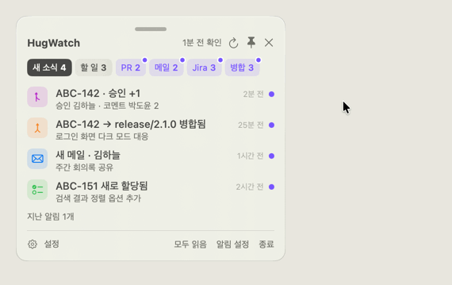
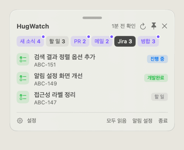
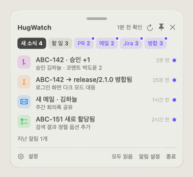
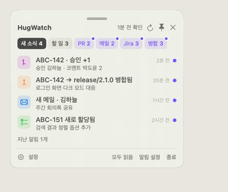

# 사용법

> 아래 화면은 모두 **더미 데이터**로 돌린 자동 시연이에요. (`HugWatch.app/Contents/MacOS/HugWatch --demo --scene tabs` 같은 식으로 직접 볼 수 있어요)

설정이 아직이면 먼저 [README의 처음 설정](../README.md#처음-설정)을 따라 해주세요.

## 메뉴바 아이콘

새 소식이 생기면 인베이더가 무지개색으로 폴짝거려요. 팝오버를 열면 멈춰요.

## 탭 둘러보기

- 칩을 누르면 탭이 바뀌어요. 칩 오른쪽 위 보라 점은 **아직 안 본 새 항목**이 있다는 뜻이에요.
- **PR**: 승인한 사람 · 코멘트한 사람 프로필이 오른쪽에 떠요.
- **병합**: D · R · M 칸이 develop · release · master 반영 여부예요. 오른쪽 배지는 Jira 상태.
- 항목을 누르면 브라우저에서 열려요.

## 우클릭으로 숨기기 · 다시 보이기

1. 안 보고 싶은 항목을 **우클릭 → 목록에서 숨기기**.
2. 숨긴 항목은 목록 아래 **숨긴 항목 n개**에 모여요. 눌러서 펼치고,
3. 다시 **우클릭 → 다시 보이기**로 되돌려요.

PR · 메일 · Jira · 병합 탭 모두 같아요.

## 할 일

- 입력칸에 쓰고 **Enter**로 추가해요.
- 동그라미를 누르면 완료. 완료한 건 아래 **완료 n개**로 접혀요.
- **우클릭**하면 완료 / 내일로 미루기 / 나중에 / 삭제.
  미룬 건 **나중에 n개**에 접혀 있어요. 내일로 미룬 건 다음 날 다시 위로 올라오고, **나중에**는 우클릭 → **오늘로** 할 때까지 그대로예요.
- `ABC-123` 같은 티켓 번호를 쓰면 Jira 링크가 돼요.

## 띄워두기 · 크게 보기

- 팝오버 오른쪽 위 창 버튼을 누르면 화면에 떠 있는 작은 창이 돼요. 위쪽 손잡이를 잡고 옮겨요.
- **⌘+ / ⌘− / ⌘0**: 글자 크기 키우기 / 줄이기 / 원래대로.
- **📌**: 켜면 항상 다른 앱 위에, 끄면 보통 창처럼 뒤로 갈 수 있어요.
